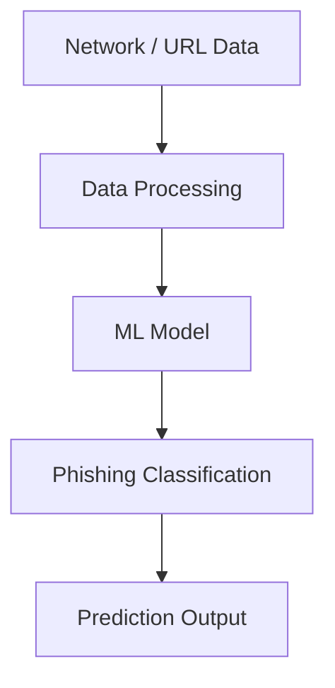
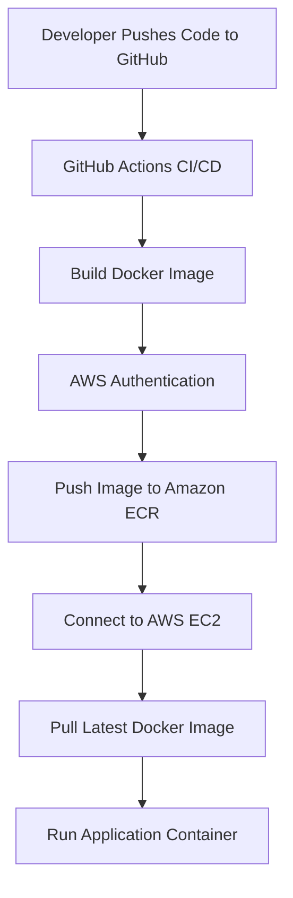
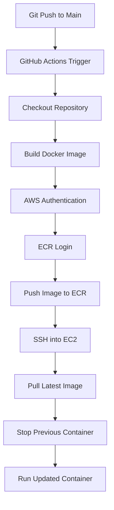

# Network Security – Phishing Detection System

## Overview

The **Network Security – Phishing Detection System** is a machine learning-based application designed to identify and classify malicious URLs to help detect potential phishing threats. It processes network-related data, applies a trained machine learning model, and provides predictions to distinguish suspicious or malicious inputs from legitimate ones.

The project follows an end-to-end machine learning and MLOps workflow, covering data processing, model training, validation, prediction, containerization, and cloud deployment. Docker is used to package the application, Amazon ECR to store container images, AWS EC2 to host the deployed application, and GitHub Actions to automate the CI/CD pipeline.

## Project Workflow



## Tech Stack

- **Python** – Application and ML implementation
- **Machine Learning** – Model training and classification
- **Docker** – Application containerization
- **AWS EC2** – Application deployment and hosting
- **Amazon ECR** – Docker image registry
- **GitHub Actions** – CI/CD automation

---

## Deployment Architecture



---

## 1. AWS ECR Setup

Create an ECR repository to store Docker images.

**Repository name:**

```text
networkssecurity
```

**AWS Region:**

```text
us-east-1
```

**ECR Repository URI:**

```text
788614365622.dkr.ecr.us-east-1.amazonaws.com/networkssecurity
```

---

## 2. GitHub Secrets and Variables Setup

Navigate to:

**GitHub Repository → Settings → Secrets and variables → Actions**

### Repository Secrets

| Secret Name | Description |
|---|---|
| `AWS_ACCESS_KEY_ID` | AWS access key |
| `AWS_SECRET_ACCESS_KEY` | AWS secret access key |
| `EC2_HOST` | Public IP address of EC2 |
| `EC2_USER` | EC2 username (usually `ubuntu`) |
| `EC2_SSH_KEY` | Private SSH key for EC2 access |

### Repository Variables

| Variable Name | Value |
|---|---|
| `AWS_REGION` | `us-east-1` |
| `AWS_ECR_LOGIN_URI` | `788614365622.dkr.ecr.us-east-1.amazonaws.com/networkssecurity` |
| `ECR_REPOSITORY_NAME` | `networkssecurity` |

> AWS credentials and SSH keys must be stored securely in GitHub Secrets and must never be committed to the repository.

---

## 3. Docker Setup on AWS EC2

Connect to your EC2 instance using SSH.

### Step 1: Update the System

```bash
sudo apt-get update -y
sudo apt-get upgrade -y
```

### Step 2: Install Docker

Download the Docker installation script:

```bash
curl -fsSL https://get.docker.com -o get-docker.sh
```

Run the installation script:

```bash
sudo sh get-docker.sh
```

### Step 3: Add Ubuntu User to Docker Group

```bash
sudo usermod -aG docker ubuntu
```

Activate the group changes:

```bash
newgrp docker
```

### Step 4: Verify Docker Installation

```bash
docker --version
```

Test Docker:

```bash
docker run hello-world
```

---

## 4. CI/CD Pipeline

The deployment pipeline automates the following steps:

1. **Code Push:** Changes pushed to the configured GitHub branch trigger the workflow.
2. **Checkout:** GitHub Actions retrieves the latest source code.
3. **Docker Build:** A Docker image is built using the project's Dockerfile.
4. **AWS Authentication:** GitHub Actions authenticates with AWS using configured credentials.
5. **ECR Login:** Docker authenticates with Amazon ECR.
6. **Image Push:** The Docker image is tagged and pushed to ECR.
7. **EC2 Deployment:** The EC2 instance retrieves the latest image and deploys the updated application container.

---

## 5. Deployment Workflow



---

## 6. Infrastructure

| Component | Purpose |
|---|---|
| GitHub | Source code management |
| GitHub Actions | CI/CD automation |
| Docker | Containerization |
| Amazon ECR | Container image storage |
| Amazon EC2 | Application hosting |
| AWS IAM | Access control and permissions |

---

## 7. Deployment Process

Whenever new changes are pushed to the configured branch:

- GitHub Actions automatically triggers the workflow.
- The application is packaged into a Docker image.
- The image is pushed to Amazon ECR.
- The EC2 instance retrieves the updated image.
- The previous container is replaced with the new container.

This enables automated deployment of the phishing detection application through a CI/CD pipeline.

---

## 8. Environment Configuration

Ensure the following are configured before deployment:

- AWS ECR repository.
- AWS EC2 instance.
- Docker installed on EC2.
- AWS IAM permissions for ECR access.
- GitHub repository secrets and variables.
- Dockerfile in the project root.
- GitHub Actions workflow under `.github/workflows/`.

